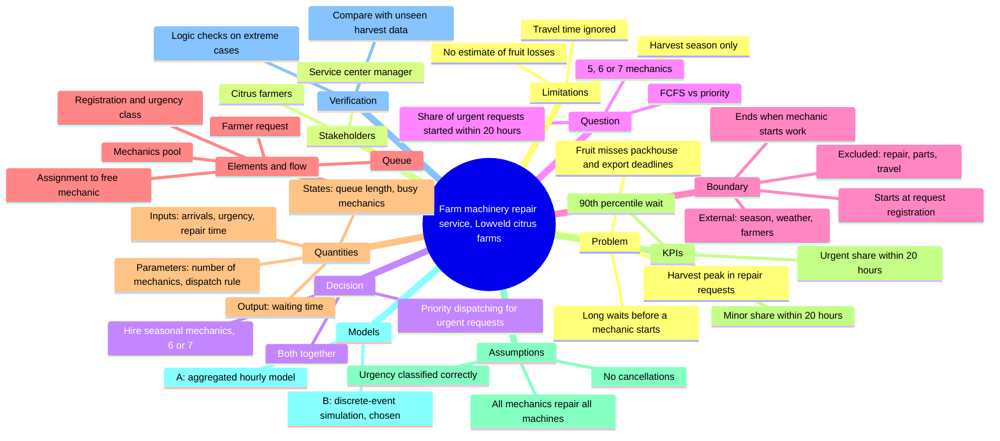

# Farm Machinery Repair Service: Model Description

## Mind map

## 1. Title and context
A service center in the Lowveld region of Mpumalanga repairs tractors and other agricultural machinery for local citrus farms. During the harvest season, it receives significantly more repair requests than in other months, and farmers report long waits between submitting a request and a mechanic starting work. These delays are costly: a broken tractor or forklift stops picked fruit from reaching the packhouse on time, which leads to quality losses and missed export deadlines. The center's management wants to reduce waiting times during peak season without permanently increasing staff costs.

## 2. Stakeholder
The service center manager, who plans staffing and dispatching. Secondary: the citrus farmers.

## 3. Decision
How to staff and organize dispatching during harvest season. Alternatives:
1. Hire 1–2 seasonal mechanics (6 or 7 instead of the current 5)
2. Introduce priority dispatching (urgent = machine stopped and needed for harvest; minor = everything else)
3. Both together

Future directions: travel time to farms, spare-parts delays, separate field and workshop crews.

## 4. Question
How will the share of urgent repair requests on which a mechanic starts work within 20 hours change during harvest season if the center operates with 5, 6 or 7 mechanics, under first-come-first-served versus priority dispatching?

## 5. Boundaries
**Start:** a repair request is registered by the dispatcher and classified as urgent or minor.
**End:** a mechanic is assigned and starts work on the request.

**Inside the model:**
- registration and urgency classification of requests
- the queue of waiting requests
- the dispatching rule (first-come-first-served or priority)
- assignment to a free mechanic
- the pool of mechanics (busy or free)

**External influences (affect the system but are not modeled):**
- harvest season and weather, which drive how often machines break down
- farmers' decisions to submit requests
- the mechanics' shift schedule

**Deliberately excluded:**
- repair duration and quality: the question is about waiting to start, not about fixing
- spare-parts availability: a separate problem needing separate data
- travel time to farms: simplified for the first version, although Lowveld farms are spread out, so this is a key future direction

**Consequence of the boundary:** because the model ends when a mechanic starts work, it can estimate the wait before service begins, but it cannot estimate total machine downtime, which also includes travel, diagnosis, waiting for parts and the repair itself. So the model cannot directly estimate how much fruit is lost.

## 6. Diagram

## 7. Quantities
| Symbol | Name and unit | Role | Source |
|---|---|---|---|
| Aₜ | New repair requests per hour, count | Input | Request log |
| uᵢ | Urgency class of request i (urgent / minor), no unit: it is a category, not a number | Input | Set by the dispatcher at registration |
| Qₜ | Requests waiting at time t, count | State | Reconstructed from the log |
| Bₜ | Mechanics busy at time t, people | State | Reconstructed from the log |
| c | Number of mechanics on shift, people | Controllable parameter | Shift schedule (5 / 6 / 7) |
| d | Dispatching rule (FCFS / priority), no unit: it is a policy choice, not a number | Controllable parameter | Management decision |
| Sᵢ | Time a mechanic spends on request i, hours | Input (determines when a mechanic becomes free again) | Log: t_finish − t_start |
| Wᵢ | Wait before work starts on request i, hours | Output | Log: t_start − t_registered |

The number of mechanics c is fixed within one scenario and changed between scenarios. Sᵢ lies outside the model boundary (the repair itself is not modeled), but it is still needed as an input because it determines when each mechanic is free to take the next request.

## 8. KPIs
All KPIs are built from the waiting time of each request:

Wᵢ = tᵢ(start) − tᵢ(registered), in hours

| KPI | Calculation | Better | Link to decision |
|---|---|---|---|
| 1. Share of urgent requests started within 20 h (main KPI) | Urgent requests with Wᵢ ≤ 20 h ÷ all urgent requests × 100% | Higher | The main number the manager compares across the 6 scenarios (5/6/7 mechanics × FCFS/priority) |
| 2. 90th percentile of waiting time for urgent requests | Sort urgent requests' Wᵢ from shortest to longest and take the value 90% of the way along: 9 in 10 urgent requests waited no longer | Lower | Shows the worst delays, which are what cause fruit losses during harvest |
| 3. Share of minor requests started within 20 h | Same as KPI 1, for minor requests | Higher, or at least not collapsing | Priority dispatching speeds up urgent requests by delaying minor ones; this KPI shows that cost |

**Why 20 hours:** picked fruit should reach the packhouse within about a day, so a stopped machine needs a mechanic to start work by the next morning at the latest.

**What the average alone hides:** an average wait of 10 hours could mean every request waits about 10 hours, or that most wait 2 hours while a few wait 3 days. Both give the same average. For citrus farmers during harvest, those rare multi-day waits are what cause losses, so the average can look acceptable while service fails exactly when it matters. The share within 20 hours and the 90th percentile show long delays directly. A single average across all requests would also hide how priority dispatching shifts waiting from urgent to minor requests, which is why the KPIs are split by urgency.

## 9. Assumptions
| Assumption | If it is wrong |
|---|---|
| Every mechanic can repair every type of machine | Waits for specialized machines (e.g. packhouse forklifts) are underestimated, because only some mechanics can take them |
| Urgency is classified correctly at registration | If farmers mark minor faults as urgent to get faster service, priority dispatching loses its effect and the KPI for urgent requests looks worse than it should |
| Requests stay in the queue until assigned (no cancellations) | If farmers give up and repair machines themselves or call another workshop, the real queue is shorter than the modeled one |
| All 5–7 mechanics are available for the whole shift | Sick days or long trips to distant farms reduce real capacity, so the model is too optimistic |

## 10. Models
Both options are classified on the same basis: the **level of detail** at which requests are described (aggregated counts vs individual requests).

### Option A: Aggregated hourly model
Tracks the number of requests arriving, started and waiting, hour by hour:

Qₜ₊₁ = Qₜ + Aₜ − (requests started in hour t)

where the number started per hour is limited by the number of free mechanics.

- **Question it answers:** how the queue length changes over a harvest day or week, and whether 5, 6 or 7 mechanics can keep up with arrivals at all.
- **Data needed:** hourly arrival counts Aₜ, average repair time, number of mechanics c.
- **What it simplifies:** treats all requests as identical and works with counts and averages, not individual requests.
- **Why choose / not choose:** simple, fast and easy to check by hand. But it cannot tell urgent requests from minor ones, so it **cannot evaluate priority dispatching**, and it cannot measure each request's wait Wᵢ, so it **cannot calculate the main KPI** (share started within 20 hours) or the 90th percentile.

### Option B: Discrete-event simulation of individual requests
Simulates each request (arrival time, urgency class) and each mechanic (busy/free) as separate objects. Events: request arrives → joins queue → assigned when a mechanic is free (by FCFS or priority rule) → mechanic busy for Sᵢ → mechanic free again.

- **Question it answers:** the full main question: the share of urgent requests started within 20 hours for each of the 6 scenarios (5/6/7 mechanics × FCFS/priority), plus the 90th percentile and the effect on minor requests.
- **Data needed:** arrival times of requests, urgency class uᵢ, repair times Sᵢ (from the log), number of mechanics c, dispatching rule d.
- **What it simplifies:** no travel time, all mechanics interchangeable, no cancellations (see assumptions, section 9).
- **Why choose / not choose:** directly calculates every KPI and can compare dispatching rules. It is more work to build and needs individual-level data. Because it includes randomness, it must be run many times to get stable results.

### Initial choice
**Option B** is chosen as the main model, because the main question depends on individual waiting times and on urgency classes. Option A cannot answer it. **Option A is still useful as a quick first check:** if it shows that 5 mechanics cannot keep up with harvest arrivals on average, Option B should show long and growing queues for that scenario too (see verification, section 11).

## 11. Verification
### Logic checks (is the model built correctly?)
Simple extreme cases where the correct result is known in advance:

1. **No new requests:** if Aₜ = 0 and mechanics are working, the queue Qₜ must not grow; it should shrink to zero.
2. **More mechanics never hurts:** with the same arrivals, going from 5 to 6 to 7 mechanics must not increase waiting times.
3. **Priority only reorders the queue:** with the same number of mechanics, switching from FCFS to priority dispatching should shorten waits for urgent requests and lengthen them for minor ones; the total number of requests served should stay about the same.
4. **Cross-check with Option A:** if the aggregated hourly model (section 10) shows that average arrivals exceed what 5 mechanics can handle, the simulation should show a growing queue for that scenario too.

### Comparison with observations (does the model match reality?)
The request log from a past harvest season is split into two parts:
- **Part 1 (e.g. the first half of the harvest):** used to set the model's inputs (arrival rates, share of urgent requests, repair times Sᵢ).
- **Part 2 (the second half):** not used for setup. The model is run for the current situation (5 mechanics, FCFS), and its results are compared with what actually happened in Part 2: the share of urgent requests started within 20 hours, the 90th percentile of waits, and the overall distribution of waiting times.

If the model's results are close to the observed ones, it can be trusted to compare the other scenarios. If not, the assumptions in section 9 are checked first, for example whether travel time or mechanic specialization needs to be added.

## 12. Limitations
1. **No estimate of fruit losses or money.** The model measures waiting time before a mechanic starts, not total downtime or how much citrus is lost. It can show which scenario reduces waits, but not whether hiring a seasonal mechanic pays for itself.

2. **Results apply to harvest-season conditions only.** The model is set up for peak-season request rates. Its conclusions cannot be transferred to the off-season or to a harvest with very different breakdown rates (for example, after an unusually wet season).

3. **Travel time is ignored.** Lowveld farms are spread out, so a mechanic travelling to a distant farm is unavailable for longer. The model may overestimate how many requests each mechanic can take on, so the real benefit of 6 or 7 mechanics may differ.

4. **The model compares scenarios; it does not predict exact numbers.** Because of the simplifying assumptions (section 9), results should be read as "scenario A is better than scenario B by roughly this much", not as exact waiting times farmers will experience.
